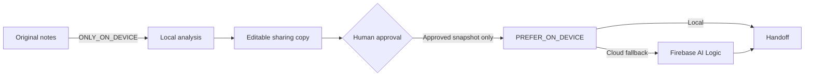

# Relay

**Turn on-call notes into clear incident handoffs with hybrid AI. Review exactly what may leave the device.**

Relay is a browser-based incident workspace for technical support and operations teams. It helps an outgoing operator preserve the timeline, distinguish facts from hypotheses, remove information from a sharing copy, and prepare a concise handoff for the next shift.

> **Project status: starter scaffold.** This repository contains the initial React/Vite app, Firebase AI Logic adapters, one fictional example, and the product/engineering notes needed to continue implementation. Real Chrome inference, App Check enforcement, request-body inspection, acceptance tests, and the public demo are not yet verified. Do not present this scaffold as a completed hackathon submission.

## Why Relay

Support notes often mix observations, actions, hypotheses, identifiers, and temporary recoveries. The next shift can mistake a short-lived recovery for a fix. Relay keeps the original visible while the operator reviews a separate copy and approves the exact text that may enter the hybrid AI path.

## The workflow

1. **Original notes:** paste an incident or load the synthetic A1 fixture. The original stays in the current browser session.
2. **On-device analysis:** use Firebase AI Logic with `ONLY_ON_DEVICE`. This path must not fall back to cloud.
3. **Human review:** inspect and edit a separate sharing copy. Pattern matches are suggestions, not proof that all sensitive data has been found.
4. **Explicit approval:** approve the exact visible copy. Any edit invalidates that approval.
5. **Hybrid handoff:** use `PREFER_ON_DEVICE` with the approved copy as the only incident payload. If the local model is unavailable, the SDK may use its cloud fallback.
6. **Final review:** inspect the four fields, preserve uncertainty, confirm review, and copy the handoff.

## Data boundary



The hybrid adapter accepts only the immutable approved string. It must never receive the original-notes store, private citations, or browser history. Relay does not intentionally persist incident content in local storage, URLs, analytics, or application logs. See [Architecture](docs/ARCHITECTURE.md) and [Requirements](docs/REQUIREMENTS.md).

## Tech stack

- React + TypeScript + Vite.
- Firebase JavaScript SDK (`firebase/ai`).
- Gemini Developer API backend through Firebase AI Logic.
- `ONLY_ON_DEVICE` for original-note analysis.
- `PREFER_ON_DEVICE` for the approved-copy handoff request.
- Firebase App Check with a web attestation provider before enabling cloud-capable generation.

## Run locally

Requirements: Node.js 20.19+ and npm.

```bash
npm install
cp .env.example .env.local
npm run dev
```

The sample and manual review flow can be explored without Firebase configuration. AI actions require a Firebase web app configuration. Hybrid generation additionally requires App Check configuration.

### Firebase configuration

1. Create or select a Firebase project and register a web app.
2. Enable Firebase AI Logic with the Gemini Developer API backend.
3. Configure a web App Check provider for the deployment domain (reCAPTCHA Enterprise is used by this starter).
4. Add the public web-app configuration and public reCAPTCHA site key to `.env.local` using `.env.example` as a guide.
5. Enforce App Check for Firebase AI Logic after verifying the app registration and provider.

The `VITE_*` values are browser-visible configuration, not a place for private secrets. Never commit service-account credentials, private keys, debug tokens, or `.env.local`.

## Commands

```bash
npm run dev       # local development server
npm run typecheck # TypeScript checks
npm test          # unit tests
npm run build     # production build
npm run preview   # preview the production build
```

## Browser and model requirements

The on-device path depends on Chrome desktop support for the Prompt API and a compatible downloaded model. The Firebase hybrid web guide currently documents Chrome desktop 139+ with the required flags enabled. The first model download can take several minutes. Verify the actual browser version, model availability, device capability, and inference source during the real test; never infer them from a UI mockup.

## Example

`examples/a1.json` contains fictional incident notes with a temporary recovery:

- Search timed out at 10:02.
- Worker restarted at 10:05.
- Search first succeeded at 10:10.
- Search timed out again at 10:18.
- A morning configuration change is suspected but has not been checked.

The expected handoff keeps the recovery temporary and the cause unconfirmed. The email and scratch marker are fictional test values.

## Delivery checklist

- [ ] Verify local-only inference while the browser tab is offline.
- [ ] Verify cloud fallback from a fresh approved copy with App Check enforced.
- [ ] Inspect the real request body and prove that original notes and excluded markers are absent.
- [ ] Verify source labels from SDK response metadata.
- [ ] Complete A1–A3 fidelity and failure tests.
- [ ] Run a clean install and production build.
- [ ] Publish a short English demo video and complete the Devpost submission.

See [Roadmap](docs/ROADMAP.md) for workstreams and target dates.

## License

Apache License 2.0. See [`LICENSE`](LICENSE).
