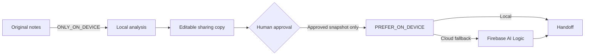

# Relay

**Turn on-call notes into clear incident handoffs with hybrid AI. Review exactly what may leave the device.**

Relay is a browser-based incident workspace for technical support and operations teams. It helps an outgoing operator preserve the timeline, distinguish facts from hypotheses, remove information from a sharing copy, and prepare a concise handoff for the next shift.

> **RC1 is ready for technical evaluation.** Chrome offline analysis, hybrid inference on device and in the cloud, and App Check were exercised against real Firebase services. [Open the free Firebase Hosting preview](https://relay-by-lotos--rc1-2uvff4zh.web.app/) · [Release evidence](docs/RELEASE-RC1-REPORT.md)

## Why Relay

Support notes often mix observations, actions, hypotheses, identifiers, and temporary recoveries. The next shift can mistake a short-lived recovery for a fix. Relay keeps the original visible while the operator reviews a separate copy and approves the exact text that may enter the hybrid AI path.

## The workflow

1. **Original notes:** paste an incident or load the synthetic A1, A2 or A3 fixture. The original stays in the current browser session.
2. **On-device analysis:** use Firebase AI Logic with `ONLY_ON_DEVICE`. This path must not fall back to cloud.
3. **Human review:** inspect and edit a separate sharing copy. Pattern matches are suggestions, not proof that all sensitive data has been found.
4. **Explicit approval:** approve the exact visible copy. Any edit invalidates that approval.
5. **Hybrid handoff:** use `PREFER_ON_DEVICE` with the approved copy as the only incident payload. If the local model is unavailable, the SDK may use its cloud fallback.
6. **Final review:** inspect the four fields, preserve uncertainty, confirm review, and copy the handoff.

## Data boundary



The hybrid adapter accepts only a revocable approval capability containing the immutable reviewed string. It must never receive the original-notes store, private citations, or browser history. Relay does not intentionally persist incident content in local storage, URLs, analytics, or application logs. See [Architecture](docs/ARCHITECTURE.md) and [Requirements](docs/REQUIREMENTS.md).

## Tech stack

- React + TypeScript + Vite.
- Firebase JavaScript SDK (`firebase/ai`).
- Gemini Developer API backend through Firebase AI Logic, with Gemini 3.5 Flash-Lite as the cloud fallback.
- `ONLY_ON_DEVICE` for original-note analysis.
- `PREFER_ON_DEVICE` for the approved-copy handoff request.
- Firebase App Check with a web attestation provider before enabling cloud-capable generation.

## Run locally

Requirements: Node.js 20.19+ and npm.

```bash
npm ci
npm run dev
```

The sample and manual review flow can be explored without Firebase configuration. AI actions require a Firebase web app configuration. Hybrid generation additionally requires App Check configuration.

### Firebase configuration

1. Create or select a Firebase project and register a web app.
2. Enable Firebase AI Logic with the Gemini Developer API backend.
3. Register the web app for App Check using score-based reCAPTCHA Enterprise. Use an approved HTTPS staging domain and a corresponding key, or a separate test app and development-only key for localhost. Keep localhost off any production key.
4. Add the public web-app configuration and public reCAPTCHA site key to `.env.local` using `.env.example` as a guide.
5. Enforce App Check for Firebase AI Logic after verifying the app registration and provider.

The `VITE_*` values are browser-visible configuration, not a place for private secrets. Never commit service-account credentials, private keys, debug tokens, or `.env.local`.

## Commands

```bash
npm run dev       # local development server
npm run typecheck # TypeScript checks
npm test          # unit tests
npm run build     # production build
npm run preview   # preview the production build
npm run format:check # formatting (no separate lint rule set is configured)
npm run check:files # essential files, license, exact dependency pins
npm run test:e2e  # Chromium UI, manual path, clipboard and accessibility
npm run test:integration # opt-in real Firebase; exits 2 if configuration missing
```

Install Playwright Chromium with `npx playwright install chromium` (use `--with-deps` on Linux CI). The deterministic suites use synthetic data, including unit SDK doubles and a real Chromium manual workflow.

The real integration suite reads `.env.local` or process variables when it starts a local server at port 4175. For an authorized HTTPS staging build with App Check already configured, set `RELAY_INTEGRATION_BASE_URL` instead. Both projects use installed desktop Chrome with a visible window. The cloud project disables the browser's Prompt API, exercises A1–A3 cloud fallback, checks the approved request body and rejects unsupported claims in the model responses. The device project tests original-note analysis offline. Use `RELAY_CHROME_TEST_PROFILE` for a dedicated Chrome test profile with the downloaded model. On Chrome versions that expose **Gemma 4 for built-in AI**, set `RELAY_CHROME_MODEL_V4=1` to request that component for the device project and check `chrome://on-device-internals` for the installed model. The suite uses genuine App Check and keeps traces, screenshots and videos disabled.

GitHub Actions runs Quality, Unit Tests, Build and Browser Tests on PRs against main, pushes to main and manual dispatch. Reports and the production bundle are downloadable artifacts.

## Browser and model requirements

The on-device path depends on Chrome desktop support for the Prompt API and a compatible downloaded model. The Firebase hybrid web guide currently documents Chrome desktop 139+ with the required flags enabled. The first model download can take several minutes. Verify the actual browser version, model availability, device capability, and inference source during the real test; never infer them from a UI mockup.

## Evaluator walkthrough

1. Open the [free evaluator preview](https://relay-by-lotos--rc1-2uvff4zh.web.app/) or run the local preview with `npm run build` and `npm run preview -- --host localhost --port 4174`.
2. In desktop Chrome, choose **Try A1**. Analyze on device, inspect the exclusions, and approve the exact sharing copy. Generate the handoff and check the source badge.
3. Review and edit the four fields, confirm **Review complete**, and copy the result. **Clear incident** starts a fresh workspace.
4. Use **Prepare manually** if the local model is unavailable. Continue manually if App Check, quota, or network conditions block hybrid generation.

The canonical fixtures are [A1](examples/a1.json) for a temporary recovery, [A2](examples/a2.json) for conflicting queue observations, and [A3](examples/a3.json) for uncertain webhook delivery. The [2:40 English demo script](docs/DEMO-SCRIPT.md) uses A1.

Detection is limited to known patterns and explicit directives. Human approval remains required. JSON shape and recorded timestamps can be checked automatically. Operators verify the meaning, attribution and severity of every sentence. Browser support, download time, network availability, quota, and App Check affect live inference.

Devpost requires an English submission, a public open-source repository, a working project with free access for judges during judging, and a public YouTube demo of up to three minutes. The deadline is November 30, 2026 at 2:00 p.m. PST (4:00 p.m. in Guadalajara). [Official rules](https://firebasehybridaihackathon.devpost.com/rules) · [Official dates](https://firebasehybridaihackathon.devpost.com/details/dates)

The [Devpost package](docs/DEVPOST-SUBMISSION.md) contains the English submission copy, evaluator instructions and publication checklist.

## License

Apache License 2.0. See [`LICENSE`](LICENSE).
